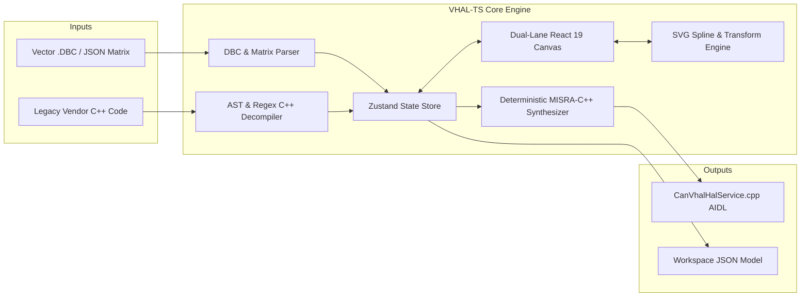

# CAN-to-AOSP VHAL Studio (`VHAL-TS`)

[](https://www.typescriptlang.org/)
[](https://react.dev/)
[](https://vitejs.dev/)
[](https://tailwindcss.com/)
[](https://source.android.com/docs/automotive/vhal)
[](https://misra.org.uk/)
[](LICENSE)

> **Automotive CAN-to-AOSP VHAL Studio** is a zero-backend, browser-based visual mapping studio, forward code synthesizer, and reverse engineering engine. It translates raw automotive Controller Area Network (CAN) signals into Android Automotive OS (AAOS / AOSP) AIDL `IVehicle` hardware abstraction layer implementations, and vice versa.

---

## 📑 Table of Contents

- [Overview](#-overview)
- [Key Features](#-key-features)
- [Architecture & Design](#-architecture--design)
- [Quick Start](#-quick-start)
- [Step-by-Step Usage Workflows](#-step-by-step-usage-workflows)
  - [1. Forward Synthesis Workflow (DBC → C++ AIDL)](#1-forward-synthesis-workflow-dbc--c-aidl)
  - [2. Reverse Reconstruction Workflow (Legacy C++ → Visual Graph)](#2-reverse-reconstruction-workflow-legacy-c--visual-graph)
  - [3. High-Capacity Stress Benchmark (150 Signals)](#3-high-capacity-stress-benchmark-150-signals)
- [AOSP VHAL Catalog](#-aosp-vhal-catalog)
- [Synthesized C++ Specification](#-synthesized-c-specification)
- [Project Directory Structure](#-project-directory-structure)
- [Testing & Verification](#-testing--verification)
- [Cross-Platform Support](#-cross-platform-support)
- [License](#-license)

---

## 🚗 Overview

Developing Vehicle Hardware Abstraction Layer (VHAL) services for Android Automotive OS (AAOS) requires bridging low-level embedded CAN message matrices (DBC files) with high-level AOSP AIDL properties (`VehiclePropValue`). This process is traditionally manual, error-prone, and difficult to audit.

**VHAL-TS** automates this pipeline with a bi-directional engine:
1. **Forward Synthesis**: Ingest Vector DBC or JSON matrix files, visually connect CAN signal pins to AOSP AIDL property targets with mathematical transfer functions, and synthesize deterministic, MISRA-C++ compliant `CanVhalHalService.cpp` code.
2. **Reverse Engineering**: Ingest legacy vendor C++ VHAL implementations, decompile switch-case bitshift extractors and math expressions back into visual nodes and splines, allowing engineers to audit, modify, and modernize existing codebases.

---

## ✨ Key Features

- **⚡ Zero-Backend Client-Side Runtime (NFR-1)**:
  - 100% in-browser execution with zero telemetry, zero server dependencies, and complete data sovereignty for confidential OEM CAN matrices.
- **🔄 Bi-Directional Engineering**:
  - **Forward**: DBC / JSON Matrix &rarr; Interactive Graph &rarr; MISRA-C++ AIDL HalService.
  - **Reverse**: Vendor C++ Code &rarr; Regex/AST Decompilation &rarr; Interactive Graph &rarr; Modified C++ Output.
- **🎨 Interactive Dual-Lane Canvas**:
  - Left lane: Active CAN signal nodes with bit range, endianness (Motorola big-endian / Intel little-endian), scale, and offset badges.
  - Right lane: Active AOSP VHAL property cards with domain tags, data types (`FLOAT`, `INT32`, `BOOLEAN`), and units.
  - Center: Hardware-accelerated SVG cubic bezier splines with interactive midpoint transformation badges (`f(x)`).
- **📐 Mathematical Transformation Builder**:
  - Linear scaling: $y = mx + b$ ($y = \text{scale} \cdot x + \text{offset}$).
  - Custom algebraic formulas: e.g., `(raw * 0.277778) - 10`.
  - Discrete state lookup tables: CAN raw integer values mapped to AIDL enum states (e.g., Gear PRNDL).
  - Bitmask & bit-shift slicing: e.g., `(raw >> 3) & 0x01` for boolean flags.
- **📚 60+ Pre-Loaded Android 13/14+ AIDL Properties**:
  - Full catalog spanning 10 vehicle domains: Powertrain, Vehicle Dynamics, Cabin, HVAC, Body, Electrification, Infotainment, ADAS, and Diagnostics.
- **🚀 High-Capacity 60 FPS Benchmark (FR-3.3)**:
  - Handles 150 CAN signals + 150 VHAL property cards (300 nodes total) and 150 SVG splines simultaneously at 60 FPS.
- **🌓 Dynamic Light & Dark Theme**:
  - Full UI theme support with an instant toggle in the navigation bar and local storage persistence.
- **💾 Workspace Import & Export**:
  - Export full mapping sessions to JSON; import and resume sessions across team members seamlessly.

---

## 🏛️ Architecture & Design



---

## 🚀 Quick Start

### Prerequisites
- **Node.js**: v18.0.0 or higher (v20+ recommended)
- **npm**: v9.0.0 or higher
- **Modern Browser**: Chrome, Edge, Firefox, Brave, or Safari

### Installation & Run

```bash
# 1. Clone the repository
git clone https://github.com/KemisettyHanya/VHAL-TS.git
cd VHAL-TS

# 2. Install dependencies
npm install

# 3. Start development server
npm run dev
```

Navigate to:
```
http://localhost:5174/
```

### Production Build & Preview
```bash
# Build optimized production bundle
npm run build

# Preview production build locally
npm run preview
```

---

## 🛠️ Step-by-Step Usage Workflows

### 1. Forward Synthesis Workflow (DBC → C++ AIDL)
1. **Load CAN Matrix**:
   - Click **Import / Export** &rarr; **Upload DBC / JSON** or click **Load Powertrain Demo DBC**.
   - CAN signals populate the searchable left palette categorized by message ID (e.g., `0x1A4 VehicleDynamics`).
2. **Add Nodes to Canvas**:
   - Click the `+` icon on any signal in the left palette to pin it to the left lane.
   - Click the `+` icon on any property in the right AOSP catalog (e.g., `PERF_VEHICLE_SPEED`) to pin it to the right lane.
3. **Wire Terminals**:
   - Drag from the output pin (cyan circle) of the CAN signal card to the input pin (emerald circle) of the target VHAL property card.
   - An SVG cubic bezier spline automatically links the two pins.
4. **Configure Transformations**:
   - Click the midpoint badge pill (`f(x)`) on any spline to open the **Transformation Configuration Modal**.
   - Select **Linear Transfer Function**, **Lookup Table / Enum Map**, **Bitmask / Bitwise**, or **Custom C++ Expression**.
5. **Synthesize C++ Code**:
   - Click **Generate C++** in the top navigation bar.
   - Review syntax-highlighted code in the slide-over drawer and click **Download .cpp** or **Copy to Clipboard**.

### 2. Reverse Reconstruction Workflow (Legacy C++ → Visual Graph)
1. Click **Reverse C++** in the header.
2. Paste existing vendor VHAL source code (or click **Load Sample Vendor C++**).
3. Click **Decompile to Visual Canvas**.
4. The AST engine automatically extracts:
   - Message switch statements (e.g., `case 0x1A4:`)
   - Bitwise shift expressions (e.g., `(frame.data[1] << 8) | frame.data[2]`)
   - Arithmetic transfer equations (e.g., `* 0.277778`)
   - Target AIDL vehicle property dispatches
5. All reconstituted nodes, connections, and transformation parameters render interactively on the visual canvas for immediate auditing and editing.

### 3. High-Capacity Stress Benchmark (150 Signals)
- Click the **150-Node Stress Test** button in the header.
- Instantly populates 150 CAN signal cards, 150 VHAL property cards (300 nodes total), and 150 active SVG splines.
- Demonstrates silky-smooth 60 FPS viewport scrolling and sub-10ms C++ code synthesis.

---

## 📊 AOSP VHAL Catalog

`VHAL-TS` includes pre-configured definitions for 60+ Android 13/14+ AIDL properties across 10 vehicle domains:

| Domain | Key AIDL Properties | Data Type | Units |
| :--- | :--- | :--- | :--- |
| **Dynamics** | `PERF_VEHICLE_SPEED`, `PERF_STEERING_ANGLE`, `PERF_ODOMETER`, `WHEEL_TICK` | `FLOAT`, `INT64` | `m/s`, `deg`, `km`, `ticks` |
| **Powertrain** | `ENGINE_RPM`, `GEAR_SELECTION`, `CURRENT_GEAR`, `ENGINE_COOLANT_TEMP` | `FLOAT`, `INT32` | `rpm`, `enum`, `celsius` |
| **Cabin** | `HVAC_TEMPERATURE_SET`, `HVAC_FAN_SPEED`, `HVAC_DEFROSTER` | `FLOAT`, `INT32`, `BOOLEAN` | `celsius`, `levels` |
| **Body** | `DOOR_LOCK`, `DOOR_POS`, `WINDOW_POS`, `HAZARD_LIGHTS_SWITCH` | `BOOLEAN`, `INT32` | `states`, `levels` |
| **Electrification** | `EV_BATTERY_LEVEL`, `EV_CHARGE_PORT_CONNECTED`, `EV_BATTERY_INSTANTANEOUS_CHARGE_RATE` | `FLOAT`, `BOOLEAN` | `Wh`, `mW` |
| **ADAS** | `CRUISE_CONTROL_ENABLED`, `LANE_DEPARTURE_WARNING_ENABLED`, `BLIND_SPOT_WARNING_STATE` | `BOOLEAN`, `INT32` | `enum`, `states` |
| **Diagnostics** | `OBD2_LIVE_FRAME`, `OBD2_FREEZE_FRAME`, `ENGINE_OIL_LEVEL` | `MIXED`, `INT32` | `standard` |

---

## 💻 Synthesized C++ Specification

Synthesized code conforms to MISRA-C++ and Google C++ Style Guide standards:

- **Target Architecture**: Android 13/14+ AIDL `android::hardware::automotive::vehicle`
- **Interface**: `onCanFrameReceived(const CanFrame& frame)`
- **Safety Characteristics**:
  - Exhaustive switch-case handling with default fallback blocks
  - Bounds-checked byte extraction using fixed-width standard integers (`uint8_t`, `uint16_t`, `uint32_t`, `uint64_t`)
  - Endianness-aware bit shifting for Motorola (Big Endian) and Intel (Little Endian)
  - Zero dynamic heap allocation in the critical frame parsing path

```cpp
// Sample synthesized snippet
void onCanFrameReceived(const CanFrame& frame) {
    switch (frame.id) {
        case 0x1A4: { // VehicleDynamics
            // Extract VehicleSpeed (Bit 7, 16-bit, Motorola / Big-Endian)
            uint16_t raw_VehicleSpeed = static_cast<uint16_t>(
                ((static_cast<uint16_t>(frame.data[1])) << 8) |
                (static_cast<uint16_t>(frame.data[2]))
            );
            float val_PERF_VEHICLE_SPEED = (static_cast<float>(raw_VehicleSpeed) * 0.010000f) + 0.000000f;
            dispatchVhalEvent(VehicleProperty::PERF_VEHICLE_SPEED, val_PERF_VEHICLE_SPEED);
            break;
        }
        default:
            break;
    }
}
```

---

## 📁 Project Directory Structure

```
VHAL-TS/
├── .github/                      # CI/CD workflows
├── scripts/
│   ├── verify_engine.ts          # 44-test automated verification suite
│   ├── verify_browser.mjs        # End-to-end headless browser benchmark script
│   └── serve.mjs                 # Zero-dependency local static server
├── src/
│   ├── components/
│   │   ├── canvas/
│   │   │   ├── CanNodeCard.tsx         # Left-lane CAN signal node card
│   │   │   ├── VhalNodeCard.tsx        # Right-lane AOSP VHAL property node card
│   │   │   ├── MappingCanvas.tsx       # Dual-lane auto-expanding canvas
│   │   │   └── SvgConnectorLayer.tsx   # Hardware-accelerated cubic bezier splines
│   │   ├── layout/
│   │   │   └── Header.tsx              # Top navigation bar & actions
│   │   ├── modals/
│   │   │   ├── CodeGenDrawer.tsx       # C++ synthesis code slide-out
│   │   │   ├── ImportExportModal.tsx   # DBC, JSON & workspace import/export
│   │   │   ├── ReverseEngineeringModal.tsx # Legacy C++ decompiler modal
│   │   │   └── TransformModal.tsx      # Mathematical transformation editor
│   │   └── panels/
│   │       ├── CanSignalPalette.tsx    # Left CAN signals drawer & search
│   │       └── VhalCatalogPalette.tsx  # Right AOSP property catalog & filters
│   ├── parsers/
│   │   ├── aospCatalog.ts        # 60+ Android 13/14+ AIDL property database
│   │   ├── cppReverseParser.ts   # AST / Regex reverse-engineering engine
│   │   └── dbcParser.ts          # Vector DBC & JSON matrix parsers
│   ├── codegen/
│   │   └── cppSynthesizer.ts     # Deterministic MISRA-C++ code generator
│   ├── store/
│   │   └── vhalStore.ts          # Reactive Zustand global store & actions
│   ├── types/
│   │   └── automotive.ts         # TypeScript data structures & models
│   ├── App.tsx                   # Main application layout
│   └── index.css                 # Tailwind CSS v4 styling & animations
├── USER_GUIDE.md                 # Complete user guide & deployment manual
├── SPEC_REQUIREMENTS.md          # Formal automotive specification requirements
├── IMPLEMENTATION_PLAN.md        # Technical design & verification milestones
├── package.json                  # Project manifest
└── vite.config.ts                # Vite configuration
```

---

## 🧪 Testing & Verification

The test engine validates DBC parsing, endianness bitshifts, C++ code generation, AST reverse decompilation, and high-capacity stress loading:

```bash
# Run unit & engine verification suite (44/44 automated tests)
npx tsx scripts/verify_engine.ts
```

All 6 test stages pass with 100% success rate:
- ✅ **Stage 1**: DBC Parser Tests (Motorola, Intel, Signed, Multiplexed)
- ✅ **Stage 2**: AOSP VHAL Catalog Tests (64 properties across 10 domains)
- ✅ **Stage 3**: C++ Synthesizer Tests (MISRA compliance, endianness, transforms)
- ✅ **Stage 4**: C++ Reverse Engineering Parser Tests (Decompilation, math extraction)
- ✅ **Stage 5**: 150-Signal High-Capacity Stress Benchmark (< 5ms synthesis)
- ✅ **Stage 6**: Architectural Constraint Validation (Zero runtime dependencies)

---

## 🖥️ Cross-Platform Support

| Platform | Supported | Notes |
| :--- | :---: | :--- |
| **Linux (Ubuntu, Debian, Fedora, Arch)** | ✅ | Native Node.js & browser execution |
| **Microsoft Windows 10 / 11** | ✅ | Native PowerShell, CMD, or WSL |
| **macOS (Apple Silicon & Intel)** | ✅ | Native Terminal & Safari/Chrome |

---

## 📄 License

This project is open-source under the [MIT License](LICENSE).
